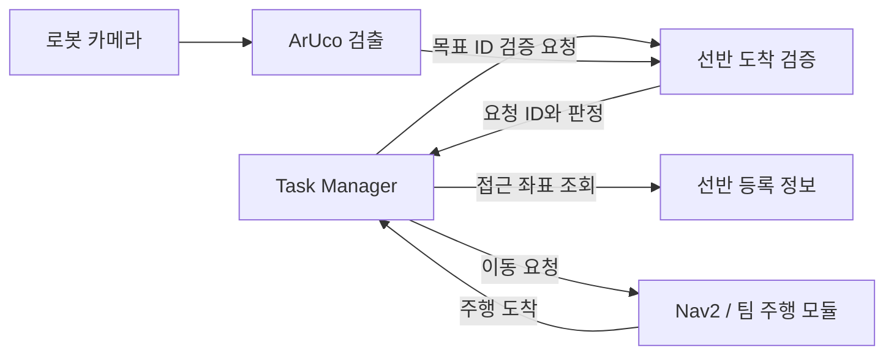

# SMART-VISION Shelf

**ArUco 선반 식별 · 접근 좌표 조회 · 주행 도착 후 마커 검증**

SMART-VISION AMR 팀 프로젝트의 선반 인식 모듈입니다. 요청한 지점으로 로봇이
이동한 뒤 카메라에 보이는 ArUco ID가 목표와 일치하는지 확인합니다.
물품 객체 검출이나 자동 적재·하역 기능은 포함하지 않습니다.

## 현재 진행 상태

| 항목 | 상태 |
|---|---|
| ID 1~4 → 선반/배송 지점 연결 | 구현 |
| 등록 접근 좌표 조회·미등록/지도 불일치 처리 | 구현 |
| ROS2 영상 입력·검출·요청별 도착 검증 | 구현 |
| 올바른/다른/미등록/복수 마커 판별 | 구현 |
| 오래된 영상·카메라 단절 처리 | 구현 |
| Gazebo 카메라에서 선반 A ID 1 확인 | 수동 재검증 성공 |
| Nav2 이동 → 선반 C ID 3 검증 | 시뮬레이션 성공 |
| 선반 C → 배송 지점 이동 → ID 4 검증 | 시뮬레이션 성공 |
| 실제 TurtleBot3·팀 Task Manager 연결 | 미검증/예정 |

2026-10-23 사용자 실행 화면을 통해 위 시뮬레이션 결과를 확인했습니다.
다중 반복 시험의 성공률이나 실물 성능을 의미하지 않습니다.
주행 중 TF 지연 경고가 남아 있어 안정화가 필요합니다.
자세한 범위는 [검증 기록](docs/VALIDATION.md)을 참고하세요.

## 시연 시나리오와 역할

| 지점 | 물품 정보 | ArUco ID |
|---|---|---:|
| 선반 A | 사전 등록된 물품 A | 1 |
| 선반 B | 사전 등록된 물품 B | 2 |
| 선반 C | 사전 등록된 물품 C | 3 |
| 배송 지점 | 작업자 하역 지점 | 4 |

물품 종류는 등록 정보입니다. 카메라로 물품 자체를 분류하지 않습니다.
적재·하역은 작업자가 수행하고 Task Manager에서 별도로 완료 확인합니다.



이 모듈은 모터 속도를 발행하거나 AMCL 초기 위치를 계산하지 않습니다.
`sim_mission.py`는 별도의 시뮬레이션 연결 예제로 Nav2 액션을 사용합니다.

## 환경

- 검증 환경: Ubuntu 22.04.5 LTS / WSL2, ROS2 Humble, Gazebo Classic, TurtleBot3 Waffle Pi
- OpenCV ArUco: 사용자 환경에서 4.5.4 확인, 신형 ArUco API도 분기 처리
- 실습용 사전: `DICT_4X4_50` — 실제 팀 마커 사전은 별도 합의 필요
- `tf2`/`tf2_ros`: 0.25.23에서 문제를 겪어 0.25.24로 업데이트 후 시험

공식 [tf2_ros 변경 기록](https://github.com/ros2/geometry2/blob/humble/tf2_ros/CHANGELOG.rst)에
0.25.24의 교착 상태 수정이 기록되어 있습니다. 이 수정이 모든 TF 지연을 해결하는 것은 아닙니다.

## 빠른 시작 — 로봇 없이 마커 시연

저장소를 내려받은 폴더에서 실행합니다.

```bash
python3 shelf_cli.py list
python3 shelf_view.py --demo
```

필요한 경우 `sudo apt install python3-opencv python3-numpy`로 설치합니다.
시연 창을 클릭하고 **소문자** 키를 입력합니다.

| 키 | 동작 |
|---|---|
| a / b / c / d | 목표 A / B / C / 배송 지점 선택 |
| 1 / 2 / 3 / 4 | 화면에 보여줄 마커 변경 |
| v | 주행 도착을 가정한 새 검증 요청 |
| n / u / m | 미검출 / 미등록 / 복수 마커 |
| x | 카메라 단절/복구 시뮬레이션 |
| q | 종료 |

예: `b → 2 → v`이면 `verified`, `b → 1 → v`이면 `wrong_location`.
생성된 마커 영상은 실제 OpenCV로 검출하지만 주행 도착은 가정한 로컬 시연입니다.

GUI 없는 논리 시연:

```bash
python3 shelf_cli.py demo B
python3 shelf_cli.py lookup B
```

기본 `locations.json`에는 실물 접근 좌표를 임의로 채우지 않았습니다.
따라서 초기 조회 결과는 `coordinates_unregistered`가 정상입니다.

## Gazebo에서 주행·마커 검증

[시뮬레이션 실행 안내](SIMULATION.md)에 네 터미널의 실행 순서를 정리했습니다.
첫 단계는 다음과 같습니다.

```bash
source sim_env.sh
python3 build_sim.py
ros2 launch ./shelf_sim.launch.py
```

생성되는 `sim/` 폴더에는 월드, 시험 지도, 전용 접근 좌표가 들어갑니다.
실물용 등록 파일을 변경하지 않습니다.
ROS 도메인 **87**, localhost 통신만 사용합니다. 실제 로봇 연결 때는 이 설정을 쓰지 마세요.

## ROS2 인터페이스

아래는 **이 모듈의 제안 인터페이스**이며 팀 전체에 합의된 규격은 아닙니다.
메시지·검증 정책·역할 경계는 [인터페이스 문서](docs/INTERFACES.md)에 설명했습니다.

| 이름 | 타입 | 용도 |
|---|---|---|
| `/shelf_vision/request` | std_msgs/String JSON | lookup / verify / cancel |
| `/shelf_vision/reply` | std_msgs/String JSON | 명령 응답 |
| `/shelf_vision/observations` | std_msgs/String JSON | 관측 ID·영상 시각 |
| `/shelf_vision/result` | std_msgs/String JSON | 요청별 검증 결과 |
| `/shelf_vision/debug` | sensor_msgs/Image | 검출 표시 영상 |
| `/shelf_vision/registry` | std_srvs/Trigger | 전체 등록 정보 조회 |

**`verified`는 요청한 지점의 마커 ID 확인입니다. 물품 적재·하역·전체 배송 완료가 아닙니다.**

## 파일 구성

```text
locations.json          지점 등록 / 검증 시간 설정
shelf_core.py           좌표 조회·도착 검증 코어
shelf_cli.py            등록 정보 조회·논리 시연
shelf_view.py           생성 마커 시연·마커 PNG 생성
shelf_ros.py            ROS2 카메라·요청·결과 연결
build_sim.py            월드·지도·시뮬레이션 좌표 생성
shelf_sim.launch.py     Gazebo와 TurtleBot3 실행
shelf_nav.launch.py     Nav2 실행
sim_mission.py          Nav2 이동 후 마커 검증 연결 예제
sim_request.py          시뮬레이션 조회·검증 요청 도구
sim_env.sh              격리된 로컬 시뮬레이션 환경
test_shelf.py           판정·시간·좌표 회귀 검사
test_sim_assets.py      생성 자산의 구조·배치 검사
docs/                   인터페이스·검증 기록
```

## 검사

코어·자산 구조 검사는 ROS와 OpenCV 없이 실행할 수 있습니다.

```bash
python3 -m unittest -v test_shelf test_sim_assets
```

현재 26개 검사 통과. 이 검사는 카메라·주행 통합 시험을 대신하지 않습니다.
시뮬레이션 편의 초기화는 정해진 출발 위치를 AMCL에 입력하는 기능이며,
ArUco/TF2 기반 자동 위치 초기화를 구현했다고 주장하지 않습니다.

## 다음 작업

- 팀 Task Manager와 요청·결과 메시지 합의 및 연결
- 실제 지도·정차 접근 좌표·카메라 토픽·마커 사전 등록
- TF 지연 원인 분석과 반복 주행 안정성 확인
- 실제 TurtleBot3에서 조명·거리·방향별 인식 검증

## 참고

ROS2 Humble/TurtleBot3/Gazebo/OpenCV를 활용했습니다.
실행 구성은 [ROBOTIS TurtleBot3 시뮬레이션 소스](https://github.com/ROBOTIS-GIT/turtlebot3_simulations/tree/humble/turtlebot3_gazebo/launch)를 확인해 작성했습니다.
다른 팀원의 주행/환경 적응 저장소를 이 저장소에 복사하거나 병합하지 않았습니다.
